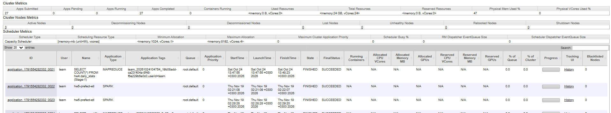

# Домашнее задание №5 — поток Prefect: Spark на YARN, HDFS, сохранение таблиц

Поток Prefect запускает Apache Spark под управлением YARN, подключается к HDFS, читает данные, выполняет трансформации и сохраняет результат как таблицы Hive. Работает поверх кластера из [ДЗ №1 (HDFS)](https://github.com/g1rone/hadoop-hw1), [ДЗ №2 (YARN)](https://github.com/g1rone/yarn-hw2), [ДЗ №3 (Hive)](https://github.com/iosmoke1/hive-hw3) и [ДЗ №4 (Spark)](https://github.com/AndreyTryak/spark-hw4). Входные данные (CSV) загружены в HDFS в ДЗ4.

## 1. Архитектура

| ВМ           | IP           | Роль в этом задании                                             |
|--------------|--------------|-----------------------------------------------------------------|
| `team-22-en` | `10.22.0.10` | Edge: здесь запускается поток Prefect и драйвер Spark, Metastore Hive |
| `team-22-nn` | `10.22.0.11` | NameNode (HDFS), ResourceManager (YARN)                         |
| `team-22-00` | `10.22.0.12` | DataNode, NodeManager (контейнеры Spark)                        |
| `team-22-01` | `10.22.0.13` | DataNode, NodeManager (контейнеры Spark)                        |

Использованы: Hadoop 3.4.1, Spark 3.5.3, Hive 4.0.0-alpha-2, Java 11, Python 3.12, Prefect 3.9.3, PySpark 3.5.3.

Prefect работает в локальном режиме (временный сервер поднимается и останавливается вместе с запуском потока), отдельный сервер Prefect не нужен. Spark запускается в режиме `master=yarn`, `deploy-mode=client`: драйвер на edge (Hive Metastore слушает только `127.0.0.1`), executor-ы в контейнерах YARN на NodeManager. Остальные настройки Spark (память, архив jar-ов в HDFS, `hive-site.xml`) берутся из `/opt/spark-3.5.3-bin-hadoop3/conf`, подготовленного в ДЗ4.

## 2. Структура репозитория

```
prefect-hw5/
├── deploy.sh                 # Проверка кластера, установка Prefect и PySpark в .venv
├── flows/
│   └── spark_etl_flow.py     # Поток Prefect (5 задач)
├── scripts/
│   ├── run.sh                # Запуск потока, лог в evidence/
│   └── verify.sh             # Проверка результата: YARN, HDFS, Beeline
├── evidence/                 # Логи запуска и проверки
└── screenshots/              # Скриншот ResourceManager
```

## 3. Развёртывание

Команды выполняются на `team-22-en` от пользователя `team`:

```
cd ~/prefect-hw5
chmod +x deploy.sh scripts/*.sh
./deploy.sh
```

`deploy.sh`:

1. Проверяет кластер: Spark установлен, три NodeManager в состоянии RUNNING, работают `hive-metastore` и `hive-server2`, входные данные есть в HDFS.
2. Проверяет поддержку виртуальных окружений Python (при необходимости ставит `python3-venv`).
3. Создаёт виртуальное окружение `.venv` и ставит `prefect` и `pyspark==3.5.3`.
4. Выводит версии.

Повторный запуск безопасен: уже установленное не переустанавливается.

## 4. Запуск

```
./scripts/run.sh
```

Скрипт запускает поток и сохраняет лог в `evidence/run_<дата>_<время>.log`. Поток можно запускать повторно: таблицы перезаписываются (`overwrite`), дубликатов не возникает.

## 5. Что делает поток

Поток `hw5-spark-yarn-etl` состоит из пяти задач, которые соответствуют шагам задания:

| № | Задача Prefect          | Что делает                                                                                                      |
|---|-------------------------|-----------------------------------------------------------------------------------------------------------------|
| 1 | `1-start-spark-on-yarn` | Запускает сессию Spark с `master=yarn` (client mode), включает поддержку Hive                                   |
| 2 | `2-connect-hdfs`        | Подключается к HDFS (`hdfs://10.22.0.11:9000`) и проверяет входной каталог `/user/team/spark-hw4/input`          |
| 3 | `3-read-data`           | Читает CSV из HDFS средствами Spark                                                                             |
| 4 | `4-transform`           | Приводит типы (`long`, `decimal(12,2)`, `timestamp`), нормализует текст, убирает пропуски и дубликаты по `event_id`, добавляет `event_date`, считает агрегаты по дню, стране и типу события (`count`, `countDistinct`, `sum`, `avg`) |
| 5 | `5-save-tables`         | Сохраняет данные как таблицы Hive `hw5.events_clean` и `hw5.daily_stats` (Parquet, партиционирование по `event_date`), данные лежат в `/user/team/spark-hw5/warehouse/hw5.db/` |

Сессия Spark останавливается в блоке `finally`, даже если одна из задач завершилась с ошибкой.

## 6. Проверка

```
./scripts/verify.sh
```

Скрипт:

1. находит в YARN завершённое приложение `hw5-prefect-etl`;
2. показывает каталоги таблиц в HDFS;
3. читает таблицы стандартным клиентом Hive (Beeline): список таблиц, число строк и суммы по датам.

Лог проверки: `evidence/verify.log`.

## 7. Результат

Проверено на учебном кластере 18 ноября 2026 года (UTC).

| Проверка                                    | Результат                                                  |
|---------------------------------------------|------------------------------------------------------------|
| Spark под управлением YARN (`master=yarn`)  | Приложение `hw5-prefect-etl`: `FINISHED / SUCCEEDED`       |
| Подключение к HDFS                          | Найдено 5 входных файлов CSV                               |
| Чтение данных                               | 7580 строк                                                 |
| Трансформации                               | 7282 строки после очистки, 150 строк агрегата              |
| Сохранение как таблиц                       | `hw5.events_clean` — 7282 строки, `hw5.daily_stats` — 150 строк |
| Чтение через Hive (Beeline)                 | Таблицы читаются, суммы совпадают с результатами ДЗ4       |
| Поток Prefect                               | `Finished in state Completed()`, все пять задач выполнены  |

Строки и сумма `amount` по датам (`hw5.events_clean`, чтение через Beeline):

```
2026-10-20  1452  840854.61
2026-10-21  1464  983596.56
2026-10-22  1458  845427.51
2026-10-23  1454  914012.84
2026-10-24  1454  897196.99
```

Логи: `evidence/`.

**ResourceManager (приложения `hw5-prefect-etl` на YARN):**


